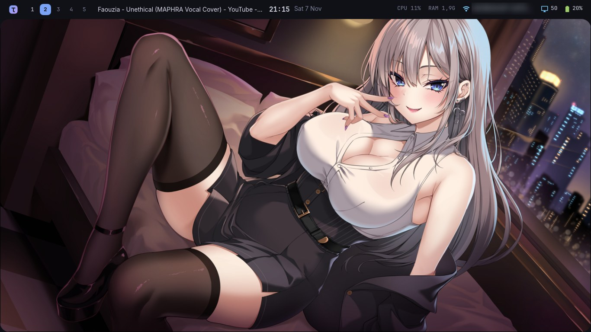
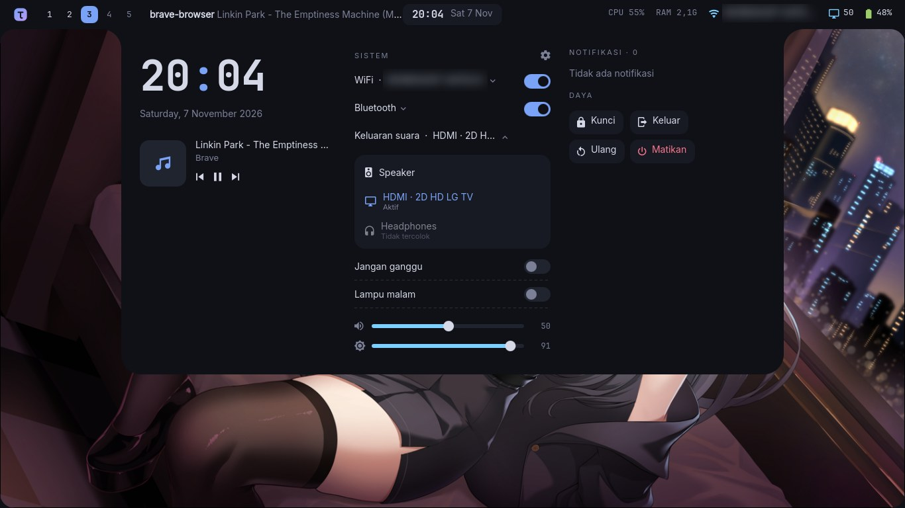
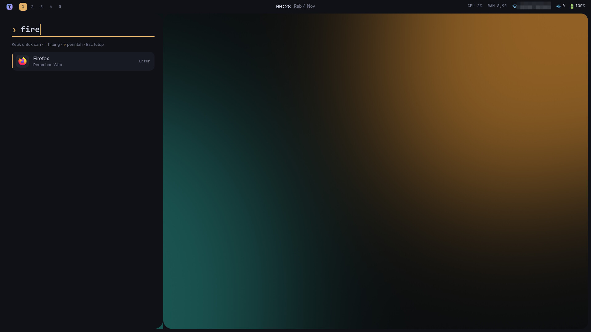
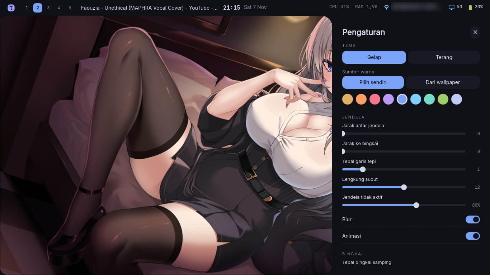
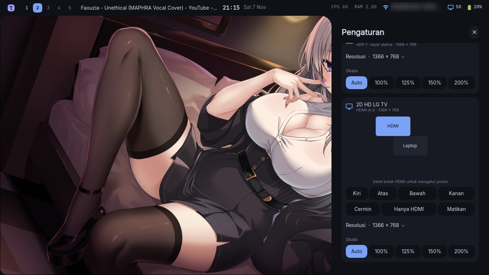
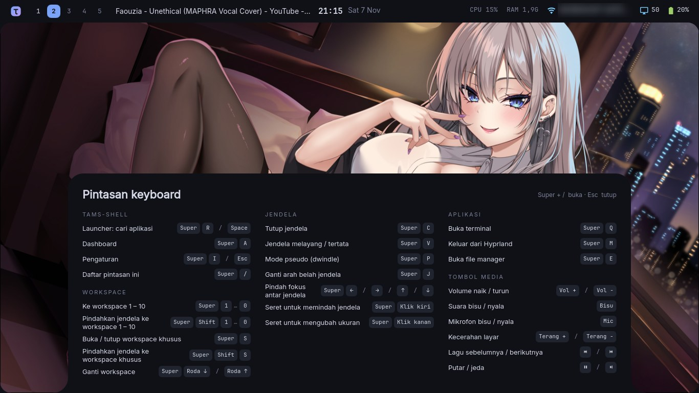

# tams-shell

**A "frame" style Hyprland shell**: the screen gets a thin frame with rounded inner corners,
system info lives in the top frame, and every panel *grows out of the frame* instead of
floating over the screen. Solid colors, no glass, no gradients.

Built with [Quickshell](https://quickshell.org), written from scratch, MIT licensed.

🇮🇩 Bahasa Indonesia: [README.md](README.md) · 💖 Support development on **[Saweria](https://saweria.co/tamsrich)**



| Dashboard (click the clock / `Super + A`) | Launcher (`Super + Space`) |
|---|---|
|  |  |

| Settings (`Super + I`) | Settings → Displays (drag the HDMI screen) |
|---|---|
|  |  |

| Shortcut list (`Super + /`) |
|---|
|  |

<sub>Wallpaper in the screenshots: [Konachan #409824](https://konachan.com/post/show/409824), not part of this repo.</sub>

## Features

- **Top frame**: logo, workspace numbers (click to switch), window title, clock, CPU, RAM, Wi-Fi, volume, battery.
- **Dashboard** from the top frame: big clock, media player (MPRIS), Wi-Fi / Bluetooth / Do-not-disturb /
  Night light toggles, volume & brightness sliders, notification list, lock / log out / reboot / power off.
- **Wi-Fi without a terminal**: click Wi-Fi in the top frame (or "WiFi" in the dashboard) to scan nearby
  networks, join a new one with its password, disconnect or forget. Needs NetworkManager (wpa_supplicant or iwd backend).
- **Bluetooth without a terminal**: click "Bluetooth" in the dashboard to discover devices, pair & connect
  headsets/speakers/mice/phones, disconnect or forget. Devices that need a typed PIN still go through `bluetoothctl`.
- **Audio output picker**: click "Keluaran suara" in the dashboard to switch between speakers, headphones, HDMI
  or a Bluetooth speaker; playing audio moves along. Headphones that are a card profile (e.g. Chromebooks) work too.
- **Launcher** from the left edge: search apps, `=` to calculate, `>` to run a command. Fully keyboard driven.
- **Notifications** slide out of the right edge (built-in notification server, no dunst/mako needed).
- **Volume & brightness OSD** on the right edge.
- **Auto-lock when idle**: dim → lock (hyprlock) → screen off → suspend, timings set in Settings → Saat ditinggal
  (default: lock after 5 minutes, screen off after 10). Playing video postpones it, the **Tetap menyala** (stay awake)
  switch in the dashboard holds it (coffee icon in the bar), and the screen is locked before the laptop sleeps or the lid
  closes. No hypridle needed.
- **Screenshots**: `Super + Shift + S` select an area (drag, or click a window), `PrtSc` this screen,
  `Shift + PrtSc` all screens, or the Area / Layar / Semua buttons in the dashboard. Saved to
  **`~/Pictures/Screenshots/Screenshot_<date>_<time>.png`** and copied to the clipboard; the notification shows a
  preview with **Buka** (open) / **Buka folder** buttons. The folder can be changed in Settings → Aplikasi.
- **Shortcut list** (`Super + /`) slides out of the bottom edge: every active Hyprland keybind and what it does,
  read live from `hyprctl binds` (your own binds show up too; give them a `description` for a nice label). A **Touchpad**
  section lists the gestures from your Hyprland config and the active touchpad settings (natural scroll, finger clicks/taps).
- Multi-monitor: one frame per screen, panels open on the focused screen.

## Install

Requires **Arch Linux** (or CachyOS, EndeavourOS, …) with **Hyprland**.

```bash
sudo pacman -S --needed git
git clone https://github.com/tammysuryana/tams-shell.git ~/tams-shell
cd ~/tams-shell
./install.sh        # --no-pkgs, --link (symlink for development), --uninstall
qs -c tams          # try it right away
```

The installer installs official-repo packages only, copies the shell to `~/.config/quickshell/tams`,
and (after asking, with a backup) hooks it into `hyprland.lua` or `hyprland.conf`.
Disable any other bar/shell you were running.

## Keys & IPC

`Super + Space` (or `Super + R`) launcher · `Super + A` dashboard · `Super + I` / `Super + Esc` settings · `Super + /` keyboard shortcut list · `Super + Shift + S` / `PrtSc` / `Shift + PrtSc` screenshot · `Esc` or click outside to close.

```bash
qs -c tams ipc call tams launcher | dashboard | wifi | bluetooth | audio | keys | screenshot <area|screen|all> | caffeine | settings | wallpaper | lock | close
```

Hyprland binds use `global, tams:launcher`, `global, tams:dashboard` and `global, tams:settings`.

## Settings

Open the **Settings** panel with `Super + I`, `Super + Esc` or the cog in the dashboard; every change applies instantly:
dark / light theme (moon / sun icons, also a quick toggle icon in the dashboard), colors picked by hand or **generated from the wallpaper** (frame, panels and window borders follow;
GTK/Chromium apps follow dark/light),
window gaps (inner/outer), border width, corner rounding, inactive window opacity, blur, animations,
accent color, side frame width, workspace count, workspace indicator style (numbers, dots, Roman numerals or kanji), terminal and wallpaper (click one from `~/Pictures`, or **Pilih file lain…** to pick any file).
**Displays**: a to-scale map where you drag the external monitor (HDMI/DP) anywhere around the laptop screen
(snaps to an edge and to top/center/bottom alignment), or use Left / Up / Down / Right; Mirror, "HDMI only"
(laptop screen off) or turn it off; resolution and scale per screen. Resolution/scale changes and "HDMI only"
revert by themselves after 15 seconds unless you keep them, and the laptop screen comes back if HDMI is unplugged.
Window and display settings are applied to the running Hyprland via `hyprctl` (and re-applied after a config reload or monitor hotplug);
your Hyprland config files are not modified.

Everything is stored in `~/.config/tams/settings.json` (live-reloaded, can be edited by hand):
`wallpaper`, `terminal`, `workspaces`, `mode` (`dark`/`light`), `colorSource` (`manual`/`wallpaper`), `accent`, `edge`, `gapsIn`, `gapsOut`, `border`, `rounding`,
`blur`, `animations`, `inactiveOpacity`, `displays`, `screenshotDir`, `workspaceStyle`, `idleDim`, `idleLock`, `idleScreenOff`, `idleSuspend` (seconds, 0 = off), `lockOnSleep`. Other colors and fonts: `config/Theme.qml`.

## License

[MIT](LICENSE) © 2026 tams. Bundled Inter font under the SIL OFL 1.1.
