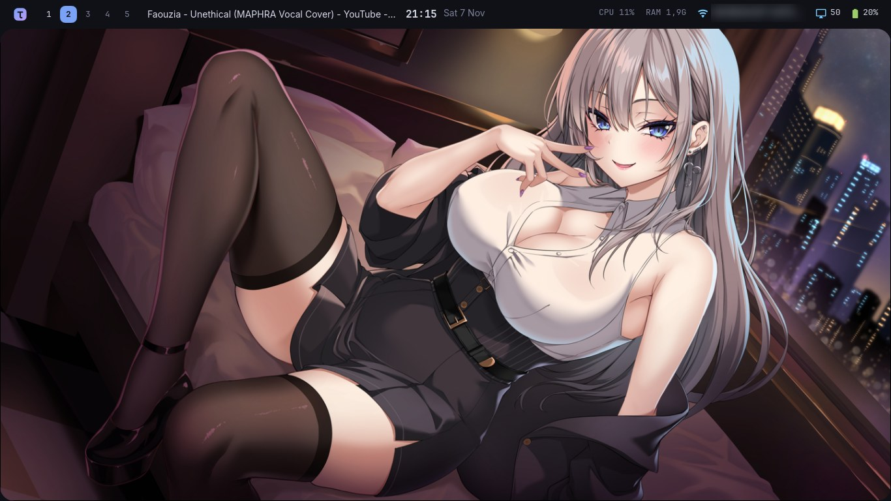
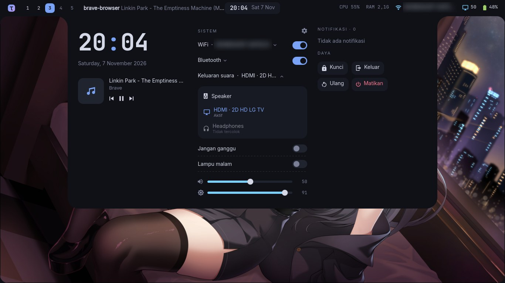
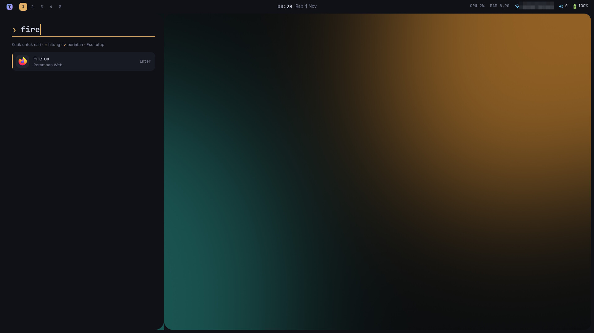

# tams-shell

**Shell Hyprland bergaya "bingkai"**: layar dibingkai tipis dengan sudut dalam melengkung,
info sistem hidup di bingkai atas, dan semua panel *tumbuh keluar dari bingkai*,
bukan melayang di atas layar. Warna solid, tanpa kaca, tanpa gradien.

Dibuat dengan [Quickshell](https://quickshell.org), ditulis dari nol, lisensi MIT.

🇬🇧 English: [README.en.md](README.en.md) · 💖 Dukung pengembangannya di **[Saweria](https://saweria.co/tamsrich)**



| Dashboard (klik jam / `Super + A`) | Launcher (`Super + Space`) |
|---|---|
|  |  |

---

## Fitur

- **Bingkai atas**: logo, nomor workspace (klik untuk pindah), judul jendela, jam,
  CPU, RAM, WiFi, volume, baterai.
- **Dashboard** keluar dari bingkai atas: jam besar, pemutar musik (Spotify, browser, dll.),
  sakelar WiFi / Bluetooth / Jangan ganggu / Lampu malam, slider volume & kecerahan,
  daftar notifikasi, tombol kunci / keluar / ulang / matikan.
- **WiFi tanpa terminal**: klik WiFi di bingkai atas (atau tulisan "WiFi" di dashboard) untuk
  memindai jaringan sekitar, sambung ke jaringan baru dengan kata sandi, putuskan, atau lupakan.
  Butuh NetworkManager (backend wpa_supplicant maupun iwd).
- **Bluetooth tanpa terminal**: klik tulisan "Bluetooth" di dashboard untuk mencari perangkat,
  pasangkan (pairing) & sambungkan headset/speaker/mouse/HP, putuskan, atau lupakan.
  Perangkat yang minta PIN diketik (sebagian keyboard) masih lewat `bluetoothctl`.
- **Pilih keluaran suara**: klik "Keluaran suara" di dashboard untuk pindah antara speaker,
  headphone, HDMI, atau speaker Bluetooth. Suara yang sedang main ikut pindah. Headphone yang
  berupa profil kartu (mis. di Chromebook) juga bisa dipilih.
- **Launcher** keluar dari sisi kiri: cari aplikasi, `=` untuk menghitung (`=1920*1080`),
  `>` untuk menjalankan perintah. Bisa dipakai penuh dengan keyboard.
- **Notifikasi** keluar dari sisi kanan bingkai (server notifikasi bawaan, tidak perlu dunst/mako).
- **Indikator volume & kecerahan** muncul di sisi kanan saat diubah.
- Banyak monitor: tiap layar punya bingkai sendiri, panel muncul di layar yang aktif.
- Teks bahasa Indonesia, nama hari/bulan ikut bahasa sistem.

---

## Pasang

Butuh **Arch Linux** (atau turunannya: CachyOS, EndeavourOS, …) dengan **Hyprland**.

```bash
sudo pacman -S --needed git
git clone https://github.com/tammysuryana/tams-shell.git ~/tams-shell
cd ~/tams-shell
./install.sh
```

Installer akan:
1. Memasang paket yang dibutuhkan. Semuanya dari repo resmi Arch: `quickshell`, `ttf-jetbrains-mono-nerd`,
   `brightnessctl`, `hyprsunset`, `hyprlock`, `networkmanager`, `bluez`, `pipewire`, dll.
2. Menyalin shell ke `~/.config/quickshell/tams`.
3. Menyambungkan ke Hyprland: jalan otomatis saat login + shortcut. Sebelum mengubah `hyprland.lua` /
   `hyprland.conf`, installer bertanya dulu dan membuat cadangan.

Coba langsung tanpa logout:

```bash
qs -c tams
```

> ⚠️ Kalau kamu sudah memakai bar/shell lain (misalnya waybar), matikan dulu
> dari config Hyprland supaya tidak tumpang tindih.

**Copot:** `./install.sh --uninstall`

---

## Tombol & perintah

| Tombol | Fungsi |
|---|---|
| `Super + Space` | Buka/tutup launcher |
| `Super + A` | Buka/tutup dashboard |
| `Super + I` / `Super + Esc` | Buka/tutup pengaturan |
| Klik jam | Dashboard |
| Klik logo | Launcher |
| `Esc` / klik di luar panel | Tutup panel |

Dari terminal / skrip:

```bash
qs -c tams ipc call tams launcher    # buka/tutup launcher
qs -c tams ipc call tams dashboard   # buka/tutup dashboard
qs -c tams ipc call tams wifi        # buka dashboard dengan daftar WiFi
qs -c tams ipc call tams bluetooth   # buka dashboard dengan daftar Bluetooth
qs -c tams ipc call tams audio       # buka dashboard dengan daftar keluaran suara
qs -c tams ipc call tams settings    # buka/tutup pengaturan
qs -c tams ipc call tams wallpaper   # pilih file wallpaper
qs -c tams ipc call tams lock        # kunci layar (hyprlock)
qs -c tams ipc call tams close       # tutup semua panel
```

Shortcut Hyprland memakai `global, tams:launcher`, `global, tams:dashboard`, dan `global, tams:settings`, jadi bebas dipasang
ke tombol lain.

---

## Pengaturan

Buka panel **Pengaturan** dengan `Super + I`, `Super + Esc`, atau ikon roda di dashboard. Semua perubahan langsung terlihat:

- **Tema**: gelap / terang, warna dipilih sendiri atau **diambil otomatis dari wallpaper**
  (bingkai, panel, garis tepi jendela ikut berubah; aplikasi GTK/Chromium ikut gelap/terang).
- **Jendela**: jarak antar jendela, jarak ke bingkai, tebal garis tepi, lengkung sudut,
  transparansi jendela tidak aktif, blur, animasi.
- **Bingkai**: tebal bingkai samping, jumlah workspace.
- **Aplikasi**: terminal yang dipakai.
- **Wallpaper**: klik gambar dari `~/Pictures` / `~/Pictures/Wallpapers`, atau **Pilih file lain…**
  untuk mengambil dari folder mana saja.

Pengaturan jendela diterapkan ke Hyprland yang sedang jalan (lewat `hyprctl`) dan diterapkan lagi
setiap kali config Hyprland dimuat ulang. File config Hyprland kamu tidak diubah.

Semuanya tersimpan di `~/.config/tams/settings.json`, yang juga bisa diedit langsung:

```json
{
  "wallpaper": "/home/kamu/Gambar/wallpaper.jpg",
  "terminal": "kitty",
  "workspaces": 5,
  "mode": "dark",
  "colorSource": "manual",
  "accent": "#e0af68",
  "edge": 10,
  "gapsIn": 2,
  "gapsOut": 2,
  "border": 2,
  "rounding": 12,
  "blur": true,
  "animations": true,
  "inactiveOpacity": 1
}
```

- `wallpaper`: kosongkan (`""`) untuk wallpaper bawaan.
- `workspaces`: jumlah nomor workspace yang selalu tampil.
- `mode`: `"dark"` atau `"light"`. `colorSource`: `"manual"` (pakai `accent`) atau `"wallpaper"`.

Warna lain dan font ada di `~/.config/quickshell/tams/config/Theme.qml`.

---

## Kalau ada masalah

| Masalah | Solusi |
|---|---|
| Bingkai tidak muncul | Jalankan `qs -c tams` di terminal dan baca pesan errornya |
| Ikon jadi kotak-kotak | `sudo pacman -S ttf-jetbrains-mono-nerd` |
| Shortcut `Super + Space` tidak jalan | Pastikan `~/.config/hypr/tams-shell.lua` (atau `.conf`) dimuat oleh config Hyprland |
| Dua bar tumpang tindih | Matikan bar/shell lama di config Hyprland |
| Slider kecerahan tidak ada | Normal di PC desktop (tidak ada lampu layar yang bisa diatur) |

---

## Dukung

tams-shell gratis. Kalau bermanfaat, dukung pengembangannya lewat **[Saweria](https://saweria.co/tamsrich)** 💖,
kasih ⭐, atau laporkan masalah di [Issues](https://github.com/tammysuryana/tams-shell/issues).

## Lisensi

[MIT](LICENSE) © 2026 tams. Font Inter disertakan dengan lisensi SIL OFL 1.1 (`shell/assets/fonts/LICENSE-Inter.txt`).
